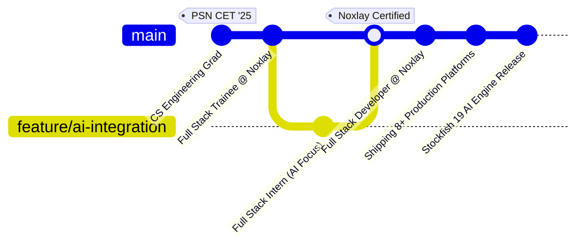

<div align="center">
  <!-- Dynamic Animated Typing Banner -->
  <a href="https://0xdevprabhu.vercel.app" target="_blank">
    
  </a>

  <p align="center">
  <sub>⚡ Crafted with clean architecture & relentless caffeine by <b>Prabhu P (@0xdevprabhu)</b> | Sivakasi, Tamil Nadu</sub>
</p>

  <!-- Quick Action Badges -->
  <p align="center">
    <a href="https://0xdevprabhu.vercel.app" target="_blank">
      
    </a>
    <a href="https://www.linkedin.com/in/0xdevprabhu" target="_blank">
      
    </a>
    <a href="mailto:0xdevprabhu@gmail.com">
      
    </a>
    <a href="https://wa.me/919344095995" target="_blank">
      
    </a>
  </p>
</div>

---

### ⚡ **The Developer Protocol**

```bash
$ npx 0xdevprabhu --status --verbose
```

```json
{
  "name": "Prabhu P",
  "handle": "@0xdevprabhu",
  "role": "Full Stack Developer",
  "company": "Noxlay Cyber Tech",
  "location": "Sivakasi, Tamil Nadu, India 🇮🇳",
  "education": "B.E. Computer Science & Engineering (PSN CET)",
  "core_philosophy": "Write clean, defendable code. Optimize queries. Ship relentlessly.",
  "status": "Available for High-Impact Engineering Roles & Collaborations 🚀"
}
```

* 🔭 Currently architecting client solutions & enterprise systems at **[Noxlay Cyber Tech](https://www.noxlay.com/)**.
* 🧠 Engineered **[ChessMate AI](https://chessmate-ai-chi.vercel.app/)** with Stockfish 19 UCI AI Engine, Python, FastAPI & Next.js.
* 📦 Shipped **8+ Live Enterprise Web Applications** handling e-commerce, real-time B2B WhatsApp estimation, and digital menus.
* 🏆 **TCS NQT National Top 30%** (70.3% Score) | **9 Verified Certifications** in LAMP, ML & AI.

---

### 🛠️ **Tech Stack & Arsenal**

<div align="center">

#### 🌐 **Frontend Engineering**
<p>
  <a href="https://skillicons.dev">
    
  </a>
</p>

#### ⚙️ **Backend & Database Systems**
<p>
  <a href="https://skillicons.dev">
    
  </a>
  <br>
  
</p>

#### 🤖 **AI Integration & Intelligence**
<p>
  
  
  
  
</p>

#### 🧰 **DevOps, Tooling & Workflow**
<p>
  <a href="https://skillicons.dev">
    
  </a>
  
  
</p>

</div>

---

### 🚀 **Featured Deployments & Live Systems**

| Project | Tech Stack | Architecture & Impact | Live Link |
| :--- | :--- | :--- | :---: |
| ♟️ **ChessMate AI** | Next.js, Python, FastAPI, Stockfish 19 | Over-the-board physical chess study companion with UCI evaluation & board position insights | [**Live Demo**](https://chessmate-ai-chi.vercel.app/) |
| 🛒 **GrocerZap.in** | PHP, MySQL, Stripe API, JS | Full-scale grocery e-commerce with cart state engine & secure online payments | [**Visit Site**](https://grocerzap.in/) |
| 🎆 **SirenPyro.in** | PHP, MySQL, Dynamic Showcase | Digital fireworks catalog with instant WhatsApp quotation & GST estimation routing | [**Visit Site**](https://sirenpyro.in/) |
| 🏭 **Factory Buddy** | PHP, JavaScript, B2B Matrix | Wholesale B2B pyrotechnics price matrix portal & automated bulk inquiry system | [**Visit Site**](https://sirenpyro.in/smartlist/factory_buddy) |
| 🍽️ **SmartMenu** | PHP, JavaScript, UI/UX | Real-time interactive restaurant dining menu SaaS with live order synchronization | [**Visit Site**](https://foodcher.com/menu/index.php?shop=great_restaurant) |
| 👗 **Niranya Fashions** | PHP, MySQL, Payment Gateway | Luxury apparel boutique storefront featuring curated galleries & mobile-first checkout | [**Visit Site**](https://niranyafashions.in/) |
| 🤖 **Agent Platform** | PHP, REST APIs, Automation | Intelligent business workflow & enterprise task automation platform | [**Visit Site**](https://smartlist.noxlay.in/expo/agent/) |
| 🏢 **Noxlay.com** | Modern Web, IT Architecture | Corporate portal showcasing IT solutions, company milestones & enterprise software | [**Visit Site**](https://www.noxlay.com/) |

---

### 📈 **Career Timeline & Milestones**



* 🚀 **Full Stack Developer** — *Noxlay Cyber Tech* `(Nov 2025 - Present)`
  * Architecting scalable SaaS products, securing database layers against SQLi/XSS/CSRF, and orchestrating full LAMP server environments.
* ⚙️ **Full Stack Intern (AI Integration)** — *Noxlay Cyber Tech* `(Aug 2025 - Nov 2025)`
  * Engineered server-side REST APIs with PHP/MySQL and integrated generative AI automation into enterprise tools.
* 🌱 **Full Stack Trainee** — *Noxlay Cyber Tech* `(May 2025 - Aug 2025)`
  * Mastered MVC design patterns, relational schemas, and responsive web principles.

---

### 📊 **GitHub Activity & Telemetry**

<div align="center">
  
  
</div>

<div align="center">
  <br>
  
</div>

---

### 🤝 **Let's Build Something Revolutionary!**

Whether you have a startup idea, want to talk about high-performance LAMP systems, or need an elite engineer to take your web product to production:

<div align="center">
  <a href="https://0xdevprabhu.vercel.app">
    
  </a>
  <a href="https://www.linkedin.com/in/0xdevprabhu">
    
  </a>
  <a href="https://github.com/0xdevprabhu">
    
  </a>
  <a href="mailto:0xdevprabhu@gmail.com">
    
  </a>
  <a href="https://wa.me/919344095995">
    
  </a>
</div>

<br>

<p align="center">
  <sub>⚡ Crafted with clean architecture & relentless caffeine by <b>Prabhu P (@0xdevprabhu)</b> • Sivakasi, Tamil Nadu</sub>
</p>

